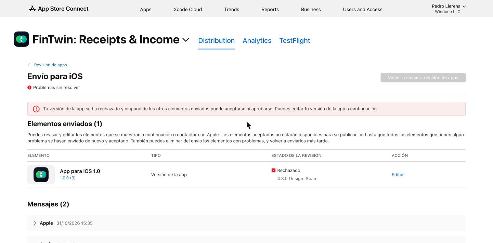
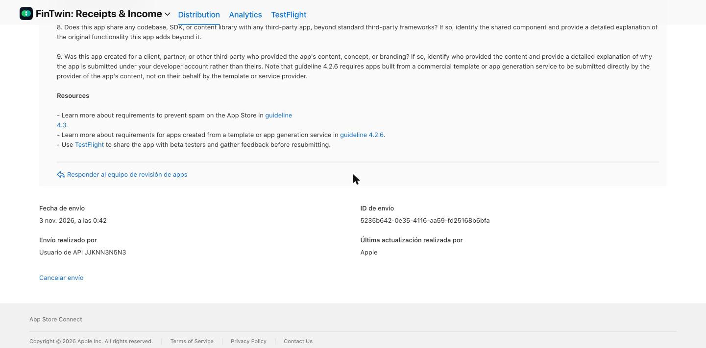
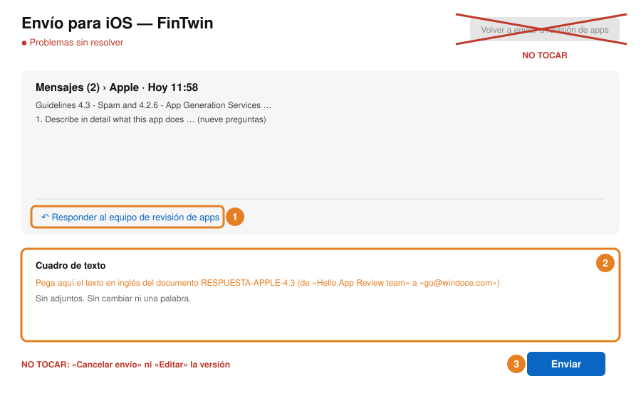

# Tutorial: el rechazo de Apple a FinTwin (3 nov 2026)

> Versión 1.0, compilación 3. Envío 5235b642-0e35-4116-aa59-fd25168b6bfa. Rechazada el 3 nov 2026 a las
> 11:58 am (Miami). Estado en App Store Connect: «Rechazado — 4.3.0 Design: Spam».
>
> **Orden vigente de Richard (3 nov):** nada sale hacia Apple —ni respuesta, ni reenvío, ni compilación, ni
> cancelación— hasta que él apruebe el estudio común de la cuenta que prepara Gerencia.

## 1. Qué dijo Apple (literal)

El texto está en App Store Connect → FinTwin → Distribution → Revisión de apps → el envío → «Mensajes (2)», el
segundo mensaje. La API pública de Apple con la llave no trae ese texto (solo dice «REJECTED»), así que se leyó en
la página, con la sesión que ya estaba abierta en Chrome, sin escribir ninguna contraseña.



```
Guidelines 4.3 - Spam and 4.2.6 - App Generation Services

Issue Description

The app does not appear to meet App Store requirements to prevent the distribution of spam submissions.

Specifically, the app appears to match one or more of the following kinds of spam, which make it harder for users to find the apps they want:

- Apps that duplicate content or functionality already on the App Store. See guideline 4.3(a).
- Apps that are indistinguishable from what's already widely available or is an opportunistic variant of an existing category or popular app. See guideline 4.3(b).
- Apps that are created from a commercialized template or app generation service but are not submitted directly by the provider of the app's content. See guideline 4.2.6.

Next Steps

If any of the above descriptions apply to this submission, do not resubmit for review until significant changes have been made to resolve this issue. If the app is resubmitted without substantial improvements, it will be rejected again, and may be rejected for additional issues.

If you believe the app already meets the requirements of guidelines 4.3(a), 4.3(b) and 4.2.6, do not resubmit the app. Instead, reply to this message and answer all of the following questions in full:

1. Describe in detail what this app does and the primary problem it solves for users. Do not use the App Store marketing description as your response.

2. Who is the intended user of this app? Provide a detailed description of the specific target audience.

3. What need or gap in the market does this app address that existing apps do not currently address, or address less effectively? Provide a detailed, substantive explanation.

4. What beta testing did you conduct before submitting the app for review? Provide examples of user feedback provided in beta that was applied to the production build.

5. Is this app intended to function as a standalone product, or is it part of a suite of related apps published under your developer account? If part of a suite, provide a detailed description of how this app's scope and functionality differ from each other app in the suite.

6. Could the functionality of this app be fully delivered as an in-app purchase, feature expansion, or content addition within any other app on your
developer account? If so, provide a detailed explanation of why this functionality was not consolidated into that existing app.

7. Does this app's binary share any significant code, frameworks, or assets with any other app on your developer account, beyond standard third-party frameworks? If so, identify each shared component and describe its role in detail.

8. Does this app share any codebase, SDK, or content library with any third-party app, beyond standard third-party frameworks? If so, identify the shared component and provide a detailed explanation of the original functionality this app adds beyond it.

9. Was this app created for a client, partner, or other third party who provided the app's content, concept, or branding? If so, identify who provided the content and provide a detailed explanation of why the app is submitted under your developer account rather than theirs. Note that guideline 4.2.6 requires apps built from a commercial template or app generation service to be submitted directly by the provider of the app's content, not on their behalf by the template or service provider.

Resources

- Learn more about requirements to prevent spam on the App Store in guideline
4.3.
- Learn more about requirements for apps created from a template or app generation service in guideline 4.2.6.
- Use TestFlight to share the app with beta testers and gather feedback before resubmitting.
```

## 2. Por qué pasó (sin adornos)

**Lo que dicen las pautas oficiales de Apple** (App Store Review Guidelines, leídas el 3 nov 2026):

- **4.3(a):** no crear varios identificadores de la misma app (su ejemplo: una app de mapas por ciudad).
- **4.3(b):** no enviar apps indistinguibles de lo que ya abunda ni «variantes oportunistas» de categorías
  existentes; los envíos repetidos de ese tipo «may lead to removal from the Apple Developer Program».
- **4.2.6:** las apps hechas con una plantilla comercial o un servicio generador de apps se rechazan si no las
  envía directamente el dueño del contenido; esos servicios no deben publicar en nombre de sus clientes.
- **4.2** (no citada en el rechazo, pero es el riesgo de fondo): la app debe ir «beyond a repackaged website».

**Lo que vio Apple, en nuestra opinión** (no lo dice Apple; es nuestra lectura de los hechos):

1. **Es una revisión de la CUENTA, no de FinTwin sola.** Apple rechazó diez apps de Windoce LLC en el mismo
   minuto. Un rechazo así de masivo sale de mirar la cuenta entera.
2. **Una sola cuenta publica muchas marcas distintas en poco tiempo** (FinTwin, Divoox, QRbott, Escenia, Mercatren,
   Kipuu y otras). Con marcas diferentes al nombre de la empresa, a Apple le parece una agencia o un generador de
   apps que publica para clientes: eso es justo la 4.2.6.
3. **Varias apps están hechas igual:** un armazón de iPhone (Expo) que muestra la web del producto. FinTwin es así:
   su app abre la web de FinTwin dentro de la app y suma avisos al celular, compartir, cámara y pantalla sin
   conexión. Muchas apps con la misma forma refuerzan la idea de «plantilla».
4. **Para FinTwin en particular**, la categoría de comprobantes e ingresos tiene apps parecidas (escáneres de
   recibos, contabilidad), y eso abre la puerta a la 4.3(b) si no se explica bien qué la hace distinta.

**El video que grabó Richard SIRVE y no hay que rehacerlo.** Motivo:

- El video lo pidió Apple el 31 oct con la guía 2.1 («Information Needed»): un video en un iPhone físico con el
  registro, la entrada y el borrado del usuario. Se adjuntó el 3 nov y ese motivo ya no aparece: el rechazo nuevo
  es solo por 4.3 y 4.2.6.
- El mensaje nuevo **no pide ningún video**: pide «reply to this message and answer all of the following
  questions in full». Las pautas 4.3 y 4.2.6 tampoco hablan de video.
- El video sigue adjunto en la información para el revisor y sigue mostrando lo que Apple pidió en la 2.1.

## 3. Qué hicimos nosotros

- **Leímos el motivo literal** y lo copiamos aquí.
- **No reenviamos, no subimos compilación y no cancelamos nada.** Apple lo pide así: si la app cumple, se contesta
  el mensaje sin reenviarla. No hace falta una compilación nueva para contestar.
- **Escribimos la respuesta a las nueve preguntas** en el documento RESPUESTA-APPLE-4.3 (carpeta docs), en
  inglés, ajustada a la línea común de la cuenta que dejó Gerencia (preguntas 5 a 9 iguales para todas las apps
  propias de Windoce) y con datos comprobables: una sola compilación de TestFlight (1.0, compilación 3), Google
  Play aprobada, y solo cambios que salieron de las pruebas reales (borrar el usuario lejos de cerrar sesión, la
  fecha que se salía de la pantalla en iPhone, el código de 6 números en vez del enlace del correo, el menú del
  inicio completo).
- **No la mandamos.** Espera el estudio común de Gerencia y el «sí» de Richard.
- **No se cambió la app.** Si el estudio común decide que hay que darle a FinTwin más funciones propias del
  iPhone (por la 4.2), eso es un trabajo aparte, con su propia compilación.

## 4. Qué tiene que hacer Richard, paso a paso

**Solo cuando Gerencia diga que ya se puede mandar.** Antes de eso, no se toca nada.

1. Entra a App Store Connect con tu cuenta → **Apps** → **FinTwin: Receipts & Income** → pestaña
   **Distribution** → a la izquierda, **Revisión de apps** → toca el envío con la marca roja «Rechazado».
2. Baja hasta el final del mensaje de Apple de hoy (el que empieza «Guidelines 4.3 - Spam»). Debajo está el
   enlace azul **«Responder al equipo de revisión de apps»**. Tócalo.

   

3. En el cuadro de texto que se abre, **pega el texto en inglés** del documento RESPUESTA-APPLE-4.3: desde
   «Hello App Review team» hasta «go@windoce.com». Sin cambiar nada y sin adjuntar archivos.
4. Toca **Enviar**.



**Qué NO tocar:**

- **«Volver a enviar a revisión de apps»** (el botón gris de arriba a la derecha). Reenviar sin cambios es otro
  rechazo y puede castigar la cuenta.
- **«Cancelar envío»** (abajo a la izquierda).
- **«Editar»** en la fila de la versión.

**Cómo saber que salió bien:** en «Mensajes» aparece un tercer mensaje, el tuyo, con la fecha de hoy. Apple
contesta a go@windoce.com, normalmente en uno a tres días, en esa misma página.
